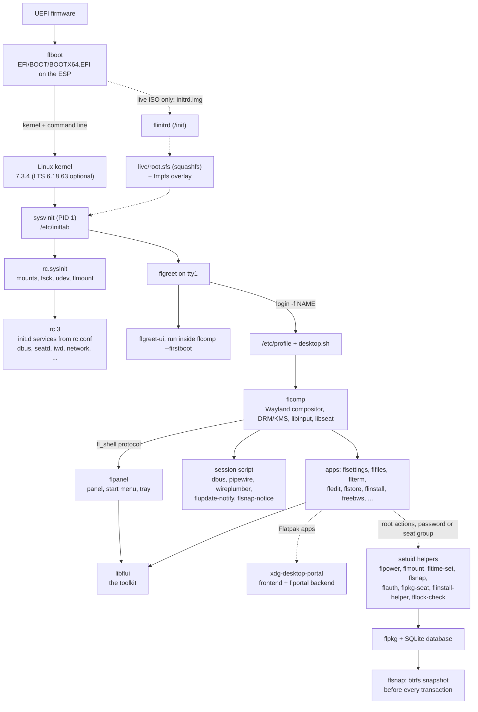

# 10. Architecture: how the pieces fit together

This chapter maps every FreeLFS component, what it does, where it is installed, and how the components talk to each other.

Status: written from the source tree at round 17 (2026-11-14). Versions are the recipe versions in `recipes/`. Anything the tree does not show is marked "not yet verified".

## Contents

1. [The big picture](#101-the-big-picture)
2. [Layers](#102-layers)
3. [Component table](#103-component-table)
4. [How the components talk](#104-how-the-components-talk)
5. [Design rules that shape the code](#105-design-rules-that-shape-the-code)
6. [Known gaps](#106-known-gaps)
7. [Where to read next](#107-where-to-read-next)

## 10.1 The big picture

Read the diagram from top to bottom: the firmware starts flboot, flboot starts the kernel, the init system starts the services, and the desktop starts when a person logs in. The dashed lines are optional paths (the live ISO only, Flatpak apps, root actions).

## 10.2 Layers

| Layer | What is in it | Chapter |
|---|---|---|
| Firmware and boot | UEFI firmware, flboot (our own boot loader), flboot-install, the boot menu | [11](11-boot-process.md) |
| Kernel | `linux` 7.3.4 (newest stable, rolling), `linux-lts` 6.18.63 (optional fallback), one shared config fragment | [11](11-boot-process.md), [17](17-hardware-drivers.md) |
| Live initramfs | flinitrd, the init that finds `root.sfs` on a CD or a stick | [11](11-boot-process.md) |
| Init and boot scripts | sysvinit 3.14, `/etc/inittab`, `/etc/rc.conf`, `rc`, `rc.sysinit`, `rc.shutdown`, `init.d/*` | [14](14-services-init.md) |
| Base system | glibc, udev 261.2 (from the systemd source, built without logind), D-Bus, seatd, iwd, dhcpcd, btrfs-progs, coreutils and the rest of LFS 13.1 | [14](14-services-init.md), [16](16-networking.md) |
| Packages and snapshots | flpkg (package manager), flsnap (btrfs snapshots), flupdate (update notice), flstore (Software Store) | [13](13-packages-flpkg.md) |
| Desktop core | flcomp (compositor), flpanel (panel), flsplash (boot screen), flgreet (login), flcrash (crash screen), fllock (lock screen), flsh (login shell) | [11](11-boot-process.md), [15](15-users-security.md) |
| Toolkit | libflui (C, the widget and drawing library every FreeLFS window uses), flpalette.h (the colours) | this chapter |
| Apps | Settings, Files, Terminal, Editor, Images, Documents, Music, Videos, Archives, Store, Packages, Installer, General Manager, Screenshot, Themes, FreeBWS browser, Sound | [17](17-hardware-drivers.md), [19](19-admin-reference.md) |
| Portal | xdg-desktop-portal (upstream 1.22.1 frontend) and flportal (our backend) for Flatpak apps | [15](15-users-security.md) |
| Security helpers | setuid programs for root actions (group `seat`, or a password from flauth) | [15](15-users-security.md) |

## 10.3 Component table

Versions come from the recipe files. Paths are where the package installs the file. "Source" is the directory in this tree.

| Component | Role | Language and library | Installed as | Source | Version |
|---|---|---|---|---|---|
| flboot | UEFI boot loader and boot menu | C, UEFI | `/usr/lib/flboot/flboot.efi`, copied to `EFI/BOOT/BOOTX64.EFI` on the ESP; `/usr/bin/flboot-install` | `src/flboot` | recipe 0.1 r6 |
| linux | Newest stable kernel | C (kernel.org source) | `/boot/vmlinuz-*` on the ESP, modules in `/usr/lib/modules` | `recipes/linux`, `config/kernel/freelfs.config` | 7.3.4 r2 |
| linux-lts | Optional 6.18 LTS fallback | same config | `vmlinuz-*-freelfs-lts` | `recipes/linux-lts` | 6.18.63 r2 |
| flinitrd | Init of the live initramfs | C, static | `/init` in the live `initrd.img` | `src/flinitrd` | 0.1 r3 |
| initscripts | inittab, rc.conf, rc scripts, init.d services | bash | `/etc/inittab`, `/etc/rc.conf`, `/etc/rc.d/*` | `config/etc` | 0.1 r11 |
| udev | Device manager, hardware database | C (systemd 261.2 udev only) | `/usr/bin/udevadm`, `/usr/lib/udev/rules.d` | `recipes/udev` | 261.2 r1 |
| flcomp | Wayland compositor and display server | C, DRM/KMS, libinput, libseat | `/usr/bin/flcomp`, session script `/usr/lib/flcomp/session`, `/etc/profile.d/desktop.sh` | `src/flcomp` | 0.1 r17 |
| flpanel | Bottom panel, start menu, notifications, desktop icons | C on libflui | `/usr/bin/flpanel`, `/usr/bin/flnotify`, `/usr/bin/flpower` | `src/flpanel` | 0.1 r16 |
| flsplash | Boot screen (pre-rendered logo) | C, KMS dumb buffers | `/usr/sbin/flsplash` | `src/flsplash` | 0.2 r4 |
| flgreet | Login screen (tty1) | C | `/usr/sbin/flgreet`, `/usr/libexec/flgreet-ui` | `src/flgreet` | 0.1 r7 |
| flcrash | "Something went wrong" screen, and the egg | C on libflui | `/usr/bin/flcrash`, `/usr/bin/flcrash-test` | `src/flcrash` | 0.1 r3 |
| fllock | Lock screen | C on libflui | `/usr/bin/fllock`, `/usr/libexec/fllock-check` (setuid) | `src/fllock` | 0.1 r2 |
| flsetup | First-boot keyboard choice | C on libflui | `/usr/bin/flsetup` | `src/flsetup` | 0.1 r2 |
| libflui | Toolkit: drawing, text, widgets, config, event loop | C17 shared library | `/usr/lib/libflui*`, `/usr/include/flui.h`, `flpalette.h` | `src/flui` | 0.1 r11 |
| flsh | Login shell and interactive shell | C, POSIX syntax | `/usr/bin/flsh` (default shell for new users) | `src/flsh` | 0.1 r2 |
| flpkg | Package manager | C, SQLite, zstd, OpenSSL | `/usr/bin/flpkg`, `/usr/lib/flpkg/` | `src/flpkg` | 0.1 r5 |
| flsnap | btrfs snapshots, rollback | C | `/usr/bin/flsnap` (setuid), `flsnap-notice`, pre-transaction hook | `src/flsnap` | 0.1 r3 |
| flupdate | Update notice (never installs) | shell | `/usr/bin/flupdate-notify` | `src/flupdate` | 0.1 r1 |
| flstore | Software Store (Flathub and FreeLFS packages) | C on libflui | `/usr/bin/flstore` | `src/flstore` | 0.1 r3 |
| flpackages | Packages app, and `flpkg-seat` (setuid helper) | C | `/usr/bin/flpackages`, `/usr/bin/flpkg-seat` | `src/flpackages` | 0.1 r4 |
| flinstall | Installer window and setuid helper | C on libflui | `/usr/bin/flinstall`, `/usr/libexec/flinstall-helper` | `src/flinstall` | 0.1 r4 |
| flsettings | Settings (display, mouse, keyboard, Wi-Fi, Bluetooth, printers, date, snapshots, about) | C on libflui | `/usr/bin/flsettings` | `src/flsettings` | 0.1 r12 |
| fldisplay | Outputs and night light from the command line | C, fl_shell | `/usr/bin/fldisplay` | `src/fldisplay` | 0.1 r1 |
| fltheme | Themes (colours, fonts, panel, animations) | C on libflui | `/usr/bin/fltheme` | `src/fltheme` | 0.1 r1 |
| general-manager | Task manager (processes, performance, startup apps); recipe `flgm` | C on libflui | `/usr/bin/general-manager` | `src/flgm` | 0.1 r1 |
| flfiles | File manager ("Files") | C on libflui | `/usr/bin/flfiles` | `src/flfiles` | 0.1 r4 |
| flterm | Terminal | C | `/usr/bin/flterm` | `src/flterm` | 0.1 r3 |
| fledit | Text editor | C on libflui | `/usr/bin/fledit` | `src/fledit` | 0.1 r2 |
| flview, flpdf, flmusic, flvideo | Images, Documents, Music, Videos | C; mupdf, GStreamer, mpv | `/usr/bin/` | `src/flview`, `src/flpdf`, `src/flmusic`, `src/flvideo` | 0.1 r5, r3, r3, r5 |
| flarchive | Archive tool | C, libarchive | `/usr/bin/flarchive` | `src/flarchive` | 0.1 r2 |
| snappel | Screenshot tool | C | `/usr/bin/snappel` | `src/snappel` | 0.1 r1 |
| flsound | System sounds (synthesised, played through PipeWire) | C | `/usr/bin/flsound` | `src/flsound` | 0.1 r1 |
| freebws | Web browser (WPE WebKit in a bubblewrap sandbox) | C on libflui; wpewebkit 2.54.2 | `/usr/bin/freebws` | `src/freebws` | 0.1 r16 |
| flportal | xdg-desktop-portal backend for Flatpak apps | C, GLib, GDBus | `/usr/libexec/flportal` | `src/flportal` | 0.1 r2 |
| flmount, flpersist | Removable drives (setuid), live persistence file | C | `/usr/bin/flmount`, `/usr/bin/flpersist` (setuid) | `src/flmount` | 0.1 r1 |
| flauth | Password prompt for root actions (setuid) | C, crypt(3) | `/usr/bin/flauth`, `/usr/libexec/flauth-dialog` | `src/flauth` | 0.1 r1 |
| fltime | Time zone and NTP helpers | C | `/usr/bin/fltime-set` (setuid), `/usr/sbin/fl-sntp` | `src/fltime` | 0.1 r1 |
| flreport | Report for bug hunting | shell | `/usr/bin/flreport` | `src/flreport` | 0.1 r2 |
| flsocketd | Starts CUPS when someone connects | C | `/usr/sbin/flsocketd` | `src/flsocketd` | 0.1 r1 |
| freebws-abpconv, libdssl | Ad-block list converter; DSSL to CSS (FreeBWS) | C | `/usr/bin/freebws-abpconv`, `/usr/bin/dssl2css` | `src/freebws`, `src/libdssl` | see recipes |

Third-party components that FreeLFS builds and uses: Mesa 26.1.7 r3 (OpenGL and Vulkan drivers), PipeWire 1.6.8 r2 with WirePlumber 0.5.15 r1, BlueZ 5.88 r1, CUPS 2.4.20 r3, iwd 3.12 r2, dhcpcd 10.5.2 r2, D-Bus 1.16.2 r1, seatd 0.9.3 r1, sysvinit 3.14, sysklogd 2.7.2, Flatpak 1.18.4 r2, Xwayland 24.1.15 r1, mpv 0.42.0 r2, FFmpeg 9.0.1 r2, btrfs-progs 7.3 r1, squashfs-tools 4.7.5 r1.

## 10.4 How the components talk

| Link | Mechanism | Who | Notes |
|---|---|---|---|
| Firmware to flboot | UEFI boot path `EFI/BOOT/BOOTX64.EFI` on the ESP | firmware, flboot | no NVRAM boot entries are needed |
| flboot to kernel | EFI stub: the kernel file, command line and `initrd=` are passed as load options | flboot, kernel | see [11](11-boot-process.md) |
| init to boot scripts | `/etc/inittab` runs `rc.sysinit` once and `rc N` per runlevel | sysvinit | |
| rc to services | `/etc/rc.d/init.d/NAME start\|stop\|status`, list in `SERVICES` of `/etc/rc.conf` | `rc` | see [14](14-services-init.md) |
| Login | `flgreet` runs `login -f NAME`; the login shell reads `/etc/profile` | flgreet, login | |
| Desktop start | `/etc/profile.d/desktop.sh` runs `flcomp` on tty1 | shell, flcomp | crash screen on failure |
| Compositor to clients | Wayland (wl_compositor, xdg-shell, zwp_linux_dmabuf_v1, wl_seat and more) | flcomp, all GUI apps | |
| Compositor to panel and settings | private `fl_shell` protocol (`src/flcomp/protocol/fl-shell.xml`, version 9); only the trusted programs may call the privileged requests | flcomp, flpanel, flsettings, fldisplay, fllock, flgreet | see [15](15-users-security.md) |
| Session services | the session script starts D-Bus session bus, pipewire, wireplumber, pipewire-pulse, flupdate-notify, flsnap-notice | flcomp session | |
| Notifications | `org.freedesktop.Notifications` on the session bus, served by flpanel | flnotify, flupdate, apps | |
| Wi-Fi | `net.connman.iwd` on the system bus | flsettings, iwd | policy file lets group `seat` talk to iwd |
| Bluetooth | `bluetoothctl` and bluetoothd | flsettings | bluetoothd runs only while an adapter exists |
| Printing | CUPS over `/run/cups/cups.sock`, opened by flsocketd | lp, lpadmin, flsettings | cupsd starts on the first connection |
| Flatpak apps | xdg-desktop-portal on the session bus, backend flportal | Flatpak apps | |
| Root actions | setuid helpers, group `seat` (mode 4750), some also ask for the password through flauth | Settings, Store, Files, panel | see [15](15-users-security.md) |
| Packages | flpkg reads and writes `/var/lib/flpkg/db.sqlite`, signed repo index | flpkg, flpkg-seat, flstore | |
| Snapshots | btrfs subvolumes `@`, `@home`, `@snapshots`; flboot lists snapshots from `/boot/flboot/snapshots` | flpkg hook, flsnap, flboot | see [12](12-filesystem-layout.md) |
| Hardware events | udev rules run `flmount --hotplug`, `bluetooth start`, the backlight rule | udev | see [14](14-services-init.md) |

## 10.5 Design rules that shape the code

These rules come from `docs/PLAN.md` and `docs/AGENT-RULES.md`:

- **Small memory.** The target is 1 GB of RAM. flcomp draws on the CPU and loads EGL and Mesa only when a client needs a GPU buffer, so a session of plain Wayland apps does not map Mesa. See [18](18-performance-ram.md).
- **No systemd.** The init is sysvinit with our own shell scripts. udev comes from the systemd source with `logind=false` and `vconsole=false`. There is no logind, so seats are handled by seatd and by the group `seat`.
- **Own code where users see it.** Compositor, panel, toolkit, apps, boot loader, package manager and shell are ours (C, MIT). Codecs, parsers, fonts, the browser engine and the kernel are upstream.
- **Rolling release.** Each package follows the newest stable upstream release of its series. Nothing is backported. The safety net is a btrfs snapshot before every package change and the LTS kernel fallback. See [11](11-boot-process.md) and [13](13-packages-flpkg.md).
- **Rootless build.** The build runs as an ordinary user. Ownership that a rootless build cannot set is recorded and applied at boot by `flpkg fix-owners`.
- **Look.** Flat, sharp corners, one palette (`src/flui/flpalette.h`), IBM Plex fonts.

## 10.6 Known gaps

The list is short here. Each chapter lists its own gaps at the end.

- Architecture: x86_64 only. Nothing has been built for aarch64.
- Hardware: the desktop ran on one AMD laptop (Ryzen 5 7520U) in earlier rounds. The M10 run there failed and was fixed. Shutdown failed on real hardware in round 17 and is being fixed in round 18. Round 17 features (Bluetooth, printing, outputs, night light) are built and tested headless only (see [17](17-hardware-drivers.md)).
- The browser is the largest single component (wpewebkit 2.54.2). Its sandbox is described in [15](15-users-security.md).
- Secure Boot is not implemented. `flboot` and the kernel are not signed (see [15](15-users-security.md)).

## 10.7 Where to read next

- [11-boot-process.md](11-boot-process.md): from power-on to the desktop, and shutdown.
- [12-filesystem-layout.md](12-filesystem-layout.md): disks, subvolumes, folders and snapshots.
- [13-packages-flpkg.md](13-packages-flpkg.md): packages, repos, updates and the Store.
- [14-services-init.md](14-services-init.md): `rc.conf`, services, udev rules.
- [15-users-security.md](15-users-security.md): accounts, login, helpers, sandbox, Secure Boot.
- [16-networking.md](16-networking.md): Wi-Fi, wired networking, DNS.
- [17-hardware-drivers.md](17-hardware-drivers.md): GPUs, firmware, sound, Bluetooth, printing, displays, power.
- [18-performance-ram.md](18-performance-ram.md): the RAM budget and what was measured.
- [19-admin-reference.md](19-admin-reference.md): every command-line tool.
- The user guide is chapters 01 to 09 in this folder (start with [01-introduction.md](01-introduction.md)). The developer guide is chapters 20 to 29 and the project's [README.md](../../README.md).
