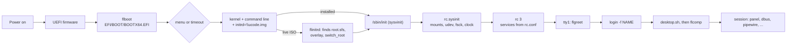

# 11. Boot process: from firmware to the desktop

This chapter follows a boot from the firmware to the login screen and the desktop, and then a shutdown. It also states the kernel policy.

Status: written from the source at round 17 (2026-11-14). Shutdown is a known open bug (see 11.7).

## Contents

1. [Kernel policy](#111-kernel-policy)
2. [The boot chain at a glance](#112-the-boot-chain-at-a-glance)
3. [Stage 1 and 2: firmware and flboot](#113-stage-1-and-2-firmware-and-flboot)
4. [Stage 3: the kernel](#114-stage-3-the-kernel)
5. [Stage 4: flinitrd on the live ISO](#115-stage-4-flinitrd-on-the-live-iso)
6. [Stage 5 to 8: init, rc.sysinit, services, login](#116-stage-5-to-8-init-rcsysinit-services-login)
7. [Shutdown and reboot](#117-shutdown-and-reboot)
8. [Boot menu keys and kernel options](#118-boot-menu-keys-and-kernel-options)
9. [Earlier states (snapshots)](#119-earlier-states-snapshots)
10. [Known issues](#1110-known-issues)

## 11.1 Kernel policy

- **Newest stable kernel.** Package `linux` is the newest stable kernel from kernel.org. Version in the tree: **7.3.4, release 2** (`recipes/linux/recipe`). Rolling release: when kernel.org publishes a newer stable series fix, the recipe moves to it. Nothing is backported.
- **One config for every kernel.** `config/kernel/freelfs.config` is carried forward with `make olddefconfig`. The recipe refuses to build when a setting in the fragment is silently dropped (see `docs/SECURITY.md`, section 0).
- **LTS fallback.** Package `linux-lts` is the newest 6.18 LTS: **6.18.63, release 2**. It uses the same config with the local version `-freelfs-lts`. It is optional: it is not in the live ISO and not in the default image. Install it with `flpkg install linux-lts`. When installed, flboot lists it as "FreeLFS (LTS kernel 6.18.63...)" after the other kernels.
- **Why both.** The newest kernel carries the newest hardware support. The LTS kernel is the way back when a new kernel breaks some hardware. Both are on the ESP, so the menu can pick either.
- **Safety net.** Packages are snapshotted before a change (see [13](13-packages-flpkg.md)). Kernels are on the ESP and are **not** part of a snapshot. Booting an old snapshot uses the newest kernel on the ESP, and that can lack the old modules (see 11.9 and 11.10).

## 11.2 The boot chain at a glance

The flsplash boot screen starts in `rc.sysinit`, before any other step, and stays on screen until the login screen takes over.

| # | Stage | Program | Where it lives | Chapter part |
|---|---|---|---|---|
| 1 | Firmware (UEFI) | the machine's firmware | motherboard | 11.3 |
| 2 | Boot loader | flboot | `EFI/BOOT/BOOTX64.EFI` on the EFI system partition (ESP, mounted at `/boot`) | 11.3 |
| 3 | Kernel | `vmlinuz-VERSION` | ESP | 11.4 |
| 4 | Live initramfs (live ISO only) | flinitrd | `initrd.img` on the ISO | 11.5 |
| 5 | PID 1 | sysvinit | `/sbin/init`, reads `/etc/inittab` | 11.6 |
| 6 | Boot setup | `rc.sysinit` | `/etc/rc.d/rc.sysinit` | 11.6 |
| 7 | Services | `rc 3` and `/etc/rc.d/init.d/*` | `SERVICES` in `/etc/rc.conf` | 11.6, [14](14-services-init.md) |
| 8 | Login | flgreet (tty1), flgreet-ui | `/usr/sbin/flgreet` | 11.6, [15](15-users-security.md) |
| 9 | Session | `desktop.sh`, flcomp, its session script | `/etc/profile.d/desktop.sh`, `/usr/lib/flcomp/session` | 11.6 |

## 11.3 Stage 1 and 2: firmware and flboot

- The firmware starts the default file `EFI/BOOT/BOOTX64.EFI` on the ESP. FreeLFS needs no NVRAM boot entries. `flboot-install` copies `/usr/lib/flboot/flboot.efi` to that path. flpkg runs it again whenever the flboot package changes (`flboot-install --update`).
- flboot reads the ESP through the firmware's file system protocol. If the firmware shows no file system on the device flboot was loaded from (some virtual disks, CDs), flboot uses the first volume that has `flboot/flboot.conf`.
- flboot finds the kernels as `\vmlinuz-*` on the ESP, newest first. If there are none it stops with "no kernels".
- Its settings are in `flboot/flboot.conf` on the ESP. One setting per line:

| Setting | Meaning |
|---|---|
| `timeout SECONDS` | countdown before the default starts; `0` starts at once, `-1` waits for a key |
| `cmdline OPTIONS...` | kernel command line for every kernel found |
| `default TEXT` | kernel version or entry title to preselect |
| `entry TITLE\|PATH\|OPTIONS` | an extra entry; PATH on the ESP, with `\` separators |

Values in the installed systems:

| Where | `timeout` | `cmdline` |
|---|---|---|
| Installer (`src/flinstall/helper.c`) | 5 | `[initrd=\ucode.img ]root=PARTUUID=<root> rootwait ro quiet panic=30 console=tty0` plus the FreeLFS console colours |
| Image build (`build/50-image.sh`, the QEMU test image) | 3 | same, plus `console=ttyS0,115200` for the serial console |

`initrd=\ucode.img` is present when the `microcode` package put `/boot/ucode.img` on the ESP. An existing install keeps its old `flboot.conf` (no microcode line) until someone adds the line and copies the file (see [17](17-hardware-drivers.md)).

## 11.4 Stage 3: the kernel

- flboot starts the kernel through its EFI stub (`CONFIG_EFI_STUB`), passing the command line as load options. The stub also loads any `initrd=` files, in order.
- The installed system has **no initramfs** (`docs/HARDWARE.md`). The kernel gets the root device from `root=PARTUUID=...`. The drivers the root device needs (btrfs, NVMe, SATA/AHCI, the file systems the boot needs) are built in. Everything else is a module that udev loads.
- The kernel mounts devtmpfs itself (`CONFIG_DEVTMPFS_MOUNT`).
- `rootwait` makes the kernel wait for the root device. `ro` mounts root read-only first; `rc.sysinit` then remounts it read-write (see 11.6).
- `panic=30` reboots 30 seconds after a kernel panic.
- The microcode file, `ucode.img`, is an uncompressed cpio with the Intel and AMD microcode. The EFI stub loads it as the first initrd, early in boot. Check it with `dmesg | grep -i microcode`.

## 11.5 Stage 4: flinitrd on the live ISO

The live ISO (`build/53-iso.sh`) uses an initramfs. Its boot entry has `initrd=\initrd.img` and no `root=`. The initramfs `/init` is **flinitrd** (`src/flinitrd`), a static C program with no busybox.

What flinitrd does, in order:

1. Waits up to `flive.timeout` seconds (default 20) for disks.
2. Looks for the live system in two ways:
   - a whole disk or partition that is ISO 9660 and holds `/live/root.sfs` (a CD, or the ISO written to a stick with `dd`);
   - a file `freelfs-live*.iso` on an exFAT, FAT, ext4 or ISO 9660 partition, at the top level or up to three directories down (a Ventoy stick).
3. Sets every device it touches to read-only in the kernel (`BLKROSET`) before mounting it, and mounts everything read-only. The personal files on a stick are never written by the boot.
4. Loop-mounts the ISO and `live/root.sfs` (squashfs), puts a tmpfs overlay on it (the writes of the session go to RAM), and calls `switch_root` to `/sbin/init`.
5. If persistence exists (`freelfs-persist.img` next to the ISO on the stick, made by `flpersist`), it mounts that image as `/home`. Without it, everything stays in RAM. See [12](12-filesystem-layout.md).
6. If nothing is found it says so and offers a small prompt: `r` retry, `l` list disks, `p` power off, `b` reboot.

Options on the kernel command line for flinitrd: `flive.timeout=SECONDS`, `flive.iso=PATTERN` (default `freelfs-live*.iso`), `flive.debug`.

## 11.6 Stage 5 to 8: init, rc.sysinit, services, login

### PID 1 and runlevels

`/etc/inittab` (sysvinit 3.14):

| Entry | Meaning |
|---|---|
| `id:3:initdefault:` | the default runlevel is 3 (multi-user, console; the desktop is started from tty1) |
| `si::sysinit:/etc/rc.d/rc.sysinit` | runs once at boot, before everything else |
| `l0` to `l6` | `/etc/rc.d/rc N` for each runlevel; 0 halts, 6 reboots |
| `su:S06:once:/sbin/sulogin` and `s1:1:respawn:/sbin/sulogin` | single-user shell |
| `1:2345:respawn:...` | tty1: `flgreet` if it exists, else the splash in text mode and `agetty` |
| `2` to `6` | agetty on tty2 to tty6 |
| `S0:2345:respawn:...` | serial console ttyS0 at 115200, 38400 or 9600 (QEMU and servers) |
| `ca:12345:ctrlaltdel:` | Ctrl+Alt+Delete reboots after 1 s |

### rc.sysinit, step by step

`/etc/rc.d/rc.sysinit` runs these steps. Each prints a status line (`[DONE]`, `[FAIL]`) unless the boot screen covers it.

| Step | What it does |
|---|---|
| (before any step) | mounts `/proc` and `/run`, starts **flsplash** (the boot screen), prints the OS name |
| Mounting kernel file systems | `/sys`, `/dev` (devtmpfs), `/dev/pts`, `/dev/shm`, cgroup2 |
| Loading kernel modules | `modprobe -a` for `MODULES` in `rc.conf` (empty by default) |
| Starting udev and waiting for devices | `udevd --daemon`, triggers add events, `udevadm settle` |
| Checking file systems | `fsck -A -T -a`. Exit 1 (errors fixed) continues. Exit 2 or 3 (a reboot is needed): reboot. Exit 4 and up (errors left): a root shell (sulogin), then reboot |
| Remounting root read-write | `mount -o remount,rw /` (not on the live overlay) |
| Mounting local file systems | `mount -a` for the non-network entries of `/etc/fstab` |
| Activating swap | `swapon -a` (the installer writes a swap line only for a swap partition made in Manual mode) |
| Live home | on a live system with persistence, copies the skeleton home into an empty `/home` |
| Setting file ownership | `flpkg fix-owners` (installed systems and the live system), or `config/ownership.list` when no flpkg exists |
| Mounting removable drives | `flmount --auto`, mounts removable disks under `/drives` and binds the live stick |
| Setting hostname | from `/etc/hostname`, else `freelfs` |
| Setting the system clock | kernel sets it from an RTC in UTC; `hwclock --hctosys` only for a local-time RTC |
| First boot: choose the keyboard | runs `flcomp --firstboot` (flsetup) when `/etc/keyboard.conf` does not exist; without a usable screen the layout stays US |
| Setting up the console | `loadkeys` and `setfont` when `KEYMAP` or `CONSOLEFONT` is set |
| Applying kernel settings | `sysctl -q --system` |
| Bringing up loopback | `ip link set lo up` |
| Setting up login records | `/run/utmp`, `/var/log/wtmp`, `lastlog`, `btmp`, `dmesg.log` |

Two details matter when a boot fails:

- The status lines go to the console, but flsplash covers them. Pressing Esc or a failing step shows them. The failing step is marked `[FAIL]`.
- Ownership and removable-drive steps run on every boot. They are short: `flpkg fix-owners` reads the database read-only when nothing is pending (see [18](18-performance-ram.md)).

### rc 3: services

`rc 3` starts every service named in `SERVICES` of `/etc/rc.conf`, in order, and then runs `/etc/rc.local` if it exists. The default order is `syslog dbus network seatd iwd bluetooth cups ntp`. Details and the enable and disable rules are in [14](14-services-init.md).

### tty1: the login screen

`/etc/inittab` runs `flgreet` on tty1, and `init` respawns it when it exits. flgreet:

1. takes tty1 as its terminal and runs `flcomp --firstboot` with `FLCOMP_SETUP=/usr/libexec/flgreet-ui`, a clean environment, and `XDG_RUNTIME_DIR=/run/flgreet`;
2. the screen (flgreet-ui) lists the accounts; a click or the keyboard picks one, and the password is checked against `/etc/shadow`;
3. on success it creates `/run/user/UID` (mode 0700, owned by the user) and runs `login -f NAME`.

If flcomp cannot start or crashes, flgreet falls back to `agetty`, so the console always works. Ctrl+Alt+F2 to F6 give plain text logins. The boot screen hands over to the login screen in about 640 ms (flgreet README).

### The desktop

When the login shell starts, `/etc/profile` runs the `/etc/profile.d/*.sh` files, including `desktop.sh` (installed by the flcomp package). `desktop.sh`:

- changes to the user's home directory;
- sets `XDG_RUNTIME_DIR` if it is not set;
- on tty1 only, and not over SSH and not when `FLCOMP_NOSTART=1`, runs `flcomp`. It does not `exec`: a shell remains after the session.
- If flcomp exits with status 0 (Log out, Ctrl+Alt+Backspace), the script exits. If it fails, it runs `flcrash`, the "Something went wrong" screen, and passes it the number of crashes in the last minute (`--crashes`). Enter starts flcomp again; Esc leaves to a shell.
- Writes flcomp's messages to `$XDG_RUNTIME_DIR/flcomp.log` and a copy to `~/.local/state/freelfs/log/`.

flcomp then starts the panel (`flpanel`, restarted up to five times if it dies) and the session script `/usr/lib/flcomp/session`. The session script starts the session D-Bus bus, PipeWire, WirePlumber, `pipewire-pulse`, `flupdate-notify`, the Flathub setup (not on the live system), and `flsnap-notice` (5 seconds after login, only on an earlier state). Autostart entries (`~/.config/autostart`, `/etc/xdg/autostart`) start three seconds after login.

## 11.7 Shutdown and reboot

Shutdown (`rc 0`) and reboot (`rc 6`) run in this order:

1. `rc` writes `/run/flshutdown`. The desktop script sees the file and does not show the crash screen.
2. `rc` starts a watchdog (`shutdown_watchdog`): after **15 seconds** the shutdown is forced whatever is stuck (`force_power`).
3. `rc` sends SIGTERM to flgreet and flcomp, waits up to 4 seconds, then SIGKILL to flcomp. The text console comes back (`flsplash --text`, `chvt 1`).
4. `rc` stops the services in reverse order, each with an 8-second timeout.
5. `rc.shutdown` saves the clock (`hwclock --systohc`, 5 s), kills the remaining processes (`killall5` TERM, then KILL, each with a timeout), turns swap off, unmounts with `umount -a -r`, remounts `/` read-only, runs `sync`, and calls `halt -d -f -p` (power off) or `reboot -d -f` (reboot).
6. If the halt call returns, `force_power` runs: sync, unmount, then the kernel's own power-off or reboot, with sysrq as the last resort.

Every step has a time limit so that a hung driver cannot block the power-off. `flpower off` and `flpower restart` (the panel's power menu) run `telinit 0` or `telinit 6` first; if init does not answer they fall back to `poweroff` or `reboot`, and then to the kernel (see [15](15-users-security.md) and [19](19-admin-reference.md)).

**Known bug:** the project brief records that shutdown **failed on real hardware in round 17**. Round 16 made changes to the same path (flpower runs poweroff itself and reports failure; flgreet and flcomp are stopped before the services; the steps above are time-limited). Round 17 did not fix the failure, and round 18 is working on it. The round 16 notes say the laptop failure was not reproduced in QEMU. The cause on the laptop is **not yet verified**.

## 11.8 Boot menu keys and kernel options

Keys in the flboot menu:

| Key | Action |
|---|---|
| Up, Down (or `k`, `j`) | choose an entry |
| Enter | start the chosen entry |
| Esc | go back from the snapshot screen |
| any other key | stop the countdown (the menu stays) |

Kernel options that FreeLFS reads:

| Option | Where | Effect |
|---|---|---|
| `root=PARTUUID=...` | installed systems | the root device |
| `rootwait` | installed systems | wait for the root device to appear |
| `ro` | installed systems | mount root read-only first; rc.sysinit makes it writable |
| `quiet` | both | fewer kernel messages on the console |
| `panic=30` | both | reboot 30 s after a kernel panic |
| `console=tty0`, `console=ttyS0,115200` | installer, image build | the screen; the serial line in the test image |
| `vt.default_red`, `_grn`, `_blu` | both | the console colours in the FreeLFS palette |
| `initrd=\ucode.img` | when microcode is installed | early microcode loading |
| `initrd=\initrd.img` | live ISO | the flinitrd initramfs |
| `rootflags=subvol=@snapshots/N` | snapshot entries | start snapshot N read-only (see 11.9) |
| `flive.timeout=N`, `flive.iso=PATTERN`, `flive.debug` | live ISO | flinitrd options (see 11.5) |

## 11.9 Earlier states (snapshots)

- The flboot menu has a second entry, **"Start an earlier state"**, when there are snapshots. Its screen lists the snapshots flsnap wrote to `/boot/flboot/snapshots`.
- Choosing one shows a notice: the state is read-only and nothing done in it is kept. Then flboot starts the newest kernel on the ESP with `rootflags=subvol=@snapshots/N`. `/tmp`, `/run` and the homes (`@home`) still work.
- To keep the earlier state, choose **"Make this the current state"** in the notice on the desktop, in Settings > Snapshots, or run `flsnap rollback` (see [13](13-packages-flpkg.md)).
- The snapshot's kernel modules must match the kernel that boots it. If a kernel update lies between the snapshot and now, the snapshot boots without its GPU, Wi-Fi and sound modules. The file systems and disk drivers are built in, so it still comes up with a plain framebuffer. Use the LTS entry if it was installed at that time. The fix is **not yet verified** (`docs/SECURITY.md` section 0, `docs/INTEGRATION-TODO.md`).

## 11.10 Known issues

| Issue | Status |
|---|---|
| Shutdown fails on real hardware (round 17 report) | open, round 18 |
| Boot of an old snapshot with a newer kernel lacks modules | open, not yet verified |
| Installed systems do not get the microcode line until flboot.conf is edited | by design for older installs; a note in 17 |
| The live ISO's boot image is limited to about 31 MB (El Torito), so the LTS kernel and the microcode are not in it | by design (`docs/HARDWARE.md`) |
| Secure Boot | not implemented: turn it off (see [15](15-users-security.md)) |
| Round 15 kernel and firmware changes (Intel and AMD) | built and run in QEMU only, not on hardware (`docs/HARDWARE.md`) |

## See also

- [10-architecture.md](10-architecture.md) for the components.
- [14-services-init.md](14-services-init.md) for `rc.conf` and the services.
- [12-filesystem-layout.md](12-filesystem-layout.md) for the partition and subvolume layout that the boot uses.
